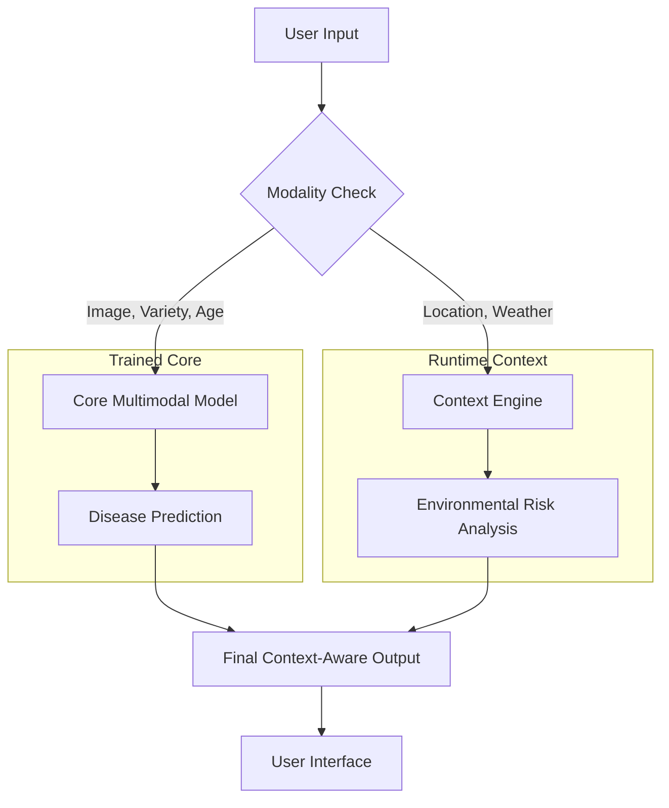

# System Architecture: Multi-Context Aware Paddy Disease Classification

## 1. High-Level Design
The system is designed as a **Context-Aware Inference Pipeline**. It distinguishes between features used for model training (Predictive Modalities) and features used for real-time interpretation (Runtime Context).

### Core Design Principle
**Scientific Honesty**: The system will never claim that runtime environmental data (e.g., current weather from an API) was used to train the core disease classifier, as the Paddy Doctor dataset does not provide historical weather per image.

---

## 2. Data Flow & Modality Fusion

### A. Core ML Prediction (Trained Modalities)
These features are fed into the Multimodal Neural Network.

**Input $\rightarrow$ Encoder $\rightarrow$ Feature Vector**
1. **Leaf Image** $\rightarrow$ ResNet-18 $\rightarrow$ 512-d Visual Vector
2. **Paddy Variety** $\rightarrow$ Embedding Layer $\rightarrow$ 16-d Variety Vector
3. **Plant Age** $\rightarrow$ MLP $\rightarrow$ 8-d Age Vector

**Fusion Process**:
$\text{Visual Vector} \oplus \text{Variety Vector} \oplus \text{Age Vector} = \text{Fused Feature Vector}$

**Output**:
The Fused Vector is passed through a classification head to produce:
- **Predicted Disease Class**
- **Confidence Score** (Softmax)
- **Top-3 Predictions**

### B. Runtime Context (Application Layer)
These features are retrieved at the moment of inference and used for contextual interpretation.

**Input Sources**:
1. **User Location** (Browser Geolocation / Manual Input) $\rightarrow$ Geocoding API $\rightarrow$ City/Region.
2. **Environmental Context** $\rightarrow$ Weather API $\rightarrow$ Current Temp, Humidity, Precipitation.

**Integration**:
The Runtime Context is **not** fed into the PyTorch model. Instead, it is combined with the model's prediction at the **Application/Decision Layer**.

---

## 3. Comprehensive Inference Pipeline

---

## 4. Context Fusion Policy
To prevent scientific inaccuracies, the system follows these rules:

| Source | Treatment | Role |
| :--- | :--- | :--- |
| **Image / Variety / Age** | Neural Network Input | Primary Predictive Feature |
| **Current Weather** | Rule-based Interpretation | Contextual Support |
| **Location** | Informational | Geographic Metadata |

**Example Output Logic**:
- **Model**: "Predicts *Blast* with 87% confidence."
- **Context**: "Current humidity is 92% (High), which is a known risk factor for *Blast*."
- **Final Result**: "Predicted: Blast. Context: High humidity supports this risk."

---

## 5. Implementation Roadmap
- **Core Model**: Implement ResNet-18 + MLP fusion.
- **Context Engine**: Integrate OpenWeather/Tomorrow.io APIs.
- **UI**: Clearly separate "Model Prediction" from "Environmental Context".
